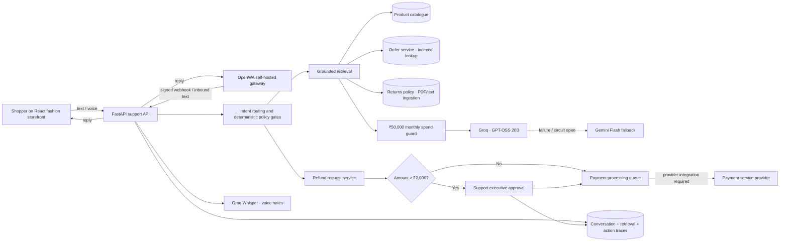

# Form & Field — Fashion Storefront + Customer Support Assistant

A responsive React clothing storefront with Women, Men, and Unisex & Accessories collections; a built-in support chat; COD checkout; and a staff workspace, backed by a FastAPI service. The support flow is designed against requirements R1–R5 in the provided Techjays system design exercise.

## Run locally

Prerequisites: Python 3.11+ and Node.js 20+.

1. Copy `.env.example` to `.env` (`Copy-Item .env.example .env` in PowerShell) and add the provider credentials you have. Keep `.env` private; never put provider tokens in React code.
2. In a terminal at the project root, create and activate a Python environment, then install the backend requirements:

   ```powershell
   py -m venv .venv
   .\.venv\Scripts\Activate.ps1
   pip install -r requirements.txt
   uvicorn backend.main:app --reload --port 8000
   ```

   If the Windows Python launcher opens the Microsoft Store, create the environment with your installed Python executable instead: `C:\Users\Lenovo\AppData\Local\Python\bin\python.exe -m venv .venv`.

3. In another terminal:

   ```powershell
   cd frontend
   npm install
   npm run dev
   ```

4. Open the Vite URL (normally `http://localhost:5173`). FastAPI docs are at `http://localhost:8000/docs`.
5. For order emails, deploy `integrations/apps-script/Code.gs` as a Google Apps Script web app (instructions below), then set `EMAIL_APPS_SCRIPT_URL` and `EMAIL_APPS_SCRIPT_TOKEN`. WhatsApp uses the self-hosted OpenWA gateway; setup is in `integrations/openwa/README.md`.

For a single-origin local production preview, run `npm run build` in `frontend`, then start FastAPI at port 8000 and open `http://localhost:8000`. FastAPI serves the compiled React app from `frontend/dist`.

With provider keys absent, the assistant uses a deterministic demo response and shows “Local demo mode”. Add `GROQ_API_KEY` to use `openai/gpt-oss-20b`; Gemini is called only if Groq is unavailable or fails. Without a Neon connection string, demo state is persisted in `data/store.json`.

## Neon order database

1. Create a Neon project and database in your Neon account, then copy the **pooled** connection string from the Connect panel. Keep the password private.
2. Put the connection string in the root `.env` as `NEON_DATABASE_URL="postgresql://..."`. The connection URL must use TLS (`sslmode=require`). Do not place it in frontend environment variables or commit it. The API uses the pure-Python `pg8000` driver.
3. Install backend dependencies and restart FastAPI:

   ```powershell
   .\.venv\Scripts\python.exe -m pip install -r requirements.txt
   .\.venv\Scripts\python.exe -m uvicorn backend.main:app --host 127.0.0.1 --port 8000
   ```

4. On startup, FastAPI applies `database/schema.sql` and hydrates the order view from Neon. Check `http://localhost:8000/api/health`; `database.configured` and `database.connected` should both be `true`. When Neon is configured but unreachable, checkout and dashboard return an error rather than silently accepting an order only into local JSON.
5. New COD orders persist customer details, totals in paise, line items, requested delivery date/time window, estimates, notification outcomes, and an initial event in one Neon transaction. Customers choose a date inside the current 4–7 day estimate and a three-hour delivery slot. Existing demo JSON orders are not imported into Neon.

## Customer and administrator accounts

- Start FastAPI, then run `\.venv\Scripts\python.exe backend\bootstrap_admin.py` from the project root. Enter and confirm the initial administrator password at the hidden terminal prompt. The script uses PBKDF2-SHA256 and writes only the salted hash plus a random session signing secret into `.env`. Change the initial demo password before deployment.
- Open **Staff workspace** in the storefront footer and sign in with the configured `ADMIN_EMAIL` (`frommahitoyou@gmail.com`). The admin session is an 8-hour signed, HTTP-only cookie; dashboard, policy, approval, messaging, and order fulfillment endpoints require that admin session.
- Customers can open **Account** to register with a name, email, phone, and password, or sign in. Account hashes are stored in Neon `user_accounts`. Registration requires Neon to be connected. Signed-in checkout pre-fills and verifies the customer's name, email, and phone from that account.
- Signed-in customers can open **Orders & returns** to see requested and estimated delivery dates, cancel an eligible unshipped order by its order ID, or request a return within the policy window. Eligible returns below ₹2,000 are automatically approved by the deterministic policy rule; returns of ₹2,000 or more wait for administrator approval. All refunds are still processed only after inspection.
- Both staff and customers can sign out; logout clears the session cookie. The API provides `POST /api/auth/register`, `POST /api/auth/login`, `GET /api/auth/me`, and `POST /api/auth/logout`.

Tables: `customers`, `orders`, `order_items`, `order_events`, `return_requests`, and `return_request_items`. Database indexes cover customer/order lookup, status/estimated delivery, and event timelines.

Order APIs:

- `GET /api/orders/{order_id}?phone=...` — customer order lookup and timeline; order ID plus phone are checked.
- `POST /api/orders/{order_id}/cancel` — request body: `{ "phone": "...", "reason": "..." }`. Cancellation is accepted only before shipment (Order placed, Confirmed, or Processing).
- `POST /api/orders/{order_id}/returns` — request body includes `phone`, `reason`, `unused: true`, and `original_packaging: true`. Only Delivered orders within the 14-day return window qualify; refunds above ₹2,000 enter executive approval.
- `PATCH /api/orders/{order_id}/status` — administrator-session protected fulfillment updates and delivery estimate changes. Body supports `status`, optional `note`, `estimated_delivery_from`, and `estimated_delivery_to`. Marking an order Delivered starts its 14-day return window. The order and event timeline are updated together.

Neon is the only persistent store for customer order data, checkout idempotency keys, status events, cancellations, and returns. `data/store.json` stores non-order demo configuration and support traces; its order, approval, and refund arrays remain empty. Orders may be cached in process memory after they are read from Neon, but are never written to that JSON file. Phone-only checks are suitable for this local prototype; production customer actions must require authenticated sessions or OTP verification and staff status updates must use proper staff authentication/RBAC.

## Architecture



### Components and choices

| Component | Choice | Reason |
| --- | --- | --- |
| Storefront and support UI | React + Vite + plain CSS | Responsive Women/Men/Unisex collection browsing, product detail/size selection, bag, COD checkout, and support chat product cards without tying the UI to a commerce vendor. |
| API and workflow | FastAPI, async HTTPX | Typed request contracts, async provider/webhook calls, automatic OpenAPI docs, and clear separation between generated text and deterministic refund actions. |
| Primary model | Groq `openai/gpt-oss-20b` | Requested model; multilingual, low-latency support responses and cost-sensitive inference. Model ID is configurable with `GROQ_MODEL`. |
| Fallback | Gemini Flash (`gemini-2.5-flash` by default) | Independent provider fallback when Groq errors or is unconfigured; model is configurable. |
| Voice notes | Groq Whisper `whisper-large-v3-turbo` | Transcribes website uploads before handing text to the same support flow. OpenWA inbound messaging currently handles text. |
| AI budget | Per-request token/audio estimate ledger with an in-process reservation lock and monthly hard stop | Prevents the prototype from continuing paid inference after the configured INR cap; estimates use editable rates and FX assumptions. |
| Product and order retrieval | Deterministic exact order-ID/phone match plus product-term matching in demo; production adapter to indexed commerce DB/search service | The model receives only selected context, not a full product or order dump. |
| Returns policy | PDF/TXT/Markdown import (PyMuPDF for PDF) | Lets the support team update the policy source. Production should chunk/version it and use a durable search index. |
| WhatsApp | OpenWA self-hosted REST gateway and HMAC-signed webhook | Handles inbound text, signature verification, duplicate event suppression, support replies, and outbound order messages. Gateway credentials remain server-side. |
| Order notifications | OpenWA WhatsApp text plus Google Apps Script web app calling `GmailApp.sendEmail` | The order is saved first; each channel reports success or failure separately so a notification issue never discards the COD order. |
| Auditability | Persist user prompt, response, provider/model, retrieved source IDs, and explicit action decision | Gives the support lead a trace for each answer and refund flow. |
| Prototype persistence | Atomic JSON file | No database or provider accounts were supplied. Replace with PostgreSQL and a durable event/audit store before real customer traffic. |

## Requirement coverage

| Requirement | Implementation and production design |
| --- | --- |
| **R1 — English, Tamil, Tanglish, voice** | The model prompt asks for the customer’s language; the chat accepts Unicode, the demo apparel catalog has Tamil/Tanglish search aliases, and website voice uploads are transcribed with Whisper before retrieval. OpenWA inbound currently supports text messages; unsupported media asks customers to type their question. Validate Tamil/Tanglish accuracy on a representative dataset; provide a typed/human route if transcription confidence is poor. |
| **R2 — Order status and refund requests** | The order view and chat look up seeded orders by exact order ID or phone. An explicit refund request, matched order, open return window, and confirmation that the item is unused and in original packaging are required before the deterministic refund workflow creates a request. The model cannot initiate it from generated text. The demo marks eligible requests as queued. A real payment-provider adapter is intentionally not simulated. |
| **R3 — Approval above ₹2,000** | The backend checks the amount before creating the request. Above ₹2,000 it creates a pending executive approval; the staff workspace can approve or decline. Approval changes the request to “approved · queued for payment processing”; actual payment/refund execution requires a payment gateway integration and its idempotency/reconciliation flow. |
| **R4 — ₹50,000 monthly AI budget and 10× peaks** | The backend reserves estimated cost before each text-model or voice call, tracks token/audio usage by month, and stops additional provider calls when estimated spend reaches the configured ceiling (including fallback calls). Rates and USD/INR conversion are configurable; defaults are estimates from the linked provider rate cards and an illustrative FX rate. Reconcile the ledger with provider billing because failed requests, rate changes, taxes, and FX can make estimates differ. For 10× peaks, production should add FAQ caching, per-customer quotas, queue-based transcription/webhooks, and horizontally scaled stateless workers; the prototype's JSON persistence and single-process budget lock are not multi-instance safe. |
| **R5 — Explain answers** | Each chat stores model/provider, matched order, product hits, policy usage, sources, selected refund action, and timestamp. Staff can inspect traces in **Staff workspace → AI traces**. In production, add retrieval passage IDs, source version/hash, prompt version, token counts, latency, and decision-rule version. |

## WhatsApp setup

Follow `integrations/openwa/README.md` to start the OpenWA Docker gateway, link a WhatsApp session by QR code, configure the FastAPI API key/session ID, and register the signed `/webhooks/openwa` callback over HTTPS. Keep OpenWA’s port bound to localhost and do not commit API keys, session files, or webhook secrets. OpenWA is an unofficial gateway and may carry account restriction risk; use a dedicated number and expected, consent-based messages. Meta Cloud API remains available only if `WHATSAPP_PROVIDER=meta` is explicitly selected and the Meta credentials are configured.

## COD checkout email setup (Google Apps Script)

1. Create a new Apps Script project and paste in `integrations/apps-script/Code.gs`.
2. In **Project Settings → Script Properties**, add `MAIL_WEBHOOK_TOKEN` with a long random secret. Put the same value in `.env` as `EMAIL_APPS_SCRIPT_TOKEN`.
3. Deploy as a **Web app**, execute as your account, and grant the Gmail send permission during the first authorization. Use the generated `/exec` URL as `EMAIL_APPS_SCRIPT_URL`.
4. Restart FastAPI. On a COD checkout, the backend writes the order, calls the script to email the customer, and sends a WhatsApp text through OpenWA. Checkout reports each message’s delivery result; a notification failure does not roll back the saved order.
5. No customer order messages can be sent until the Apps Script URL/token and a linked OpenWA session/API key are configured. Obtain customer consent and follow applicable WhatsApp terms and local messaging rules.

## Assumptions and production gaps

- The provided exercise defines policy and approval requirements, but contains no actual product feed, PDF policy text, order schema, payment gateway, Meta credentials, authentication system, or invoice-project source/design. The storefront uses clearly fictional fashion products and sample orders; replace them with the store’s real catalogue and branding.
- Search uses a small in-memory demo catalogue. For approximately 2,000 products, sync product content into PostgreSQL plus a search index (or a managed search service); reindex on catalogue changes. Never load the 500,000-order table into the model or browser. Query the source order system by indexed order ID and authenticated customer identity, with least-privilege read access.
- The JSON file store is only for local demonstration. Use PostgreSQL transactions for refund requests/approvals, Redis for cache/rate limits, and a durable queue such as SQS/RabbitMQ/Kafka for WhatsApp events and payment work. Add idempotency keys to webhook and refund operations.
- Add customer OTP/step-up identity checks for order/refund actions, CSRF protections for state-changing cookie-authenticated actions, rate limits and lockout, webhook replay protection, managed secrets, PII retention controls, and encrypted storage before deployment. Initial admin login uses a password set in the local bootstrap script; rotate it before deployment.
- A request is not a payment refund. A payment provider integration must confirm returns/inspection, submit the refund once, reconcile provider webhooks, and notify the customer; the prototype explicitly stops at the processing queue.
- The budget ledger is an estimate based on token/audio usage, configurable rate-card defaults, and `AI_USD_TO_INR`; it is not vendor billing telemetry. Reconcile it with provider invoices/usage exports, FX, tax, and future rate changes. Configure an early warning threshold and make the ledger transactional across workers before production.
- Product photography uses remote Unsplash sample images. Replace with owned/CDN-hosted assets and the real fashion catalogue before launch.
- COD order creation and notifications use demo JSON storage; connect the production commerce/order database and delivery/fulfilment system before accepting real orders. Google Apps Script’s Gmail quotas and Meta’s WhatsApp policies apply.

## Useful endpoints

- `GET /api/health` — configured provider flags, no secret values.
- `GET /api/catalog` — demo products and Women/Men/Unisex collection counts.
- `GET /api/dashboard` — demo orders, approvals, traces, products, and current policy.
- `POST /api/chat` — assistant conversation; `{ "text": "...", "channel": "web", "lang": "auto" }`.
- `POST /api/checkout` — validated COD order creation with per-channel notification results.
- `POST /api/transcribe` — multipart audio upload.
- `POST /api/approvals/{approval_id}` — `{ "decision": "approve" | "decline", "reviewer": "..." }`.
- `POST /api/policy/upload` — multipart PDF, TXT, or Markdown policy import.
- `POST /webhooks/openwa` — signed OpenWA inbound message webhook.
- `GET|POST /webhooks/whatsapp` — optional Meta Cloud API webhook.
- `GET /docs` — FastAPI OpenAPI interface.

## Official API references

- [Groq supported models](https://console.groq.com/docs/models)
- [Groq GPT-OSS 20B model and pricing](https://console.groq.com/docs/model/openai/gpt-oss-20b)
- [Groq chat completions](https://console.groq.com/docs/api-reference)
- [Google Gemini generateContent](https://ai.google.dev/api/generate-content)
- [Gemini API pricing](https://ai.google.dev/gemini-api/docs/pricing)
- [OpenWA setup and API documentation](https://docs.open-wa.org/)
